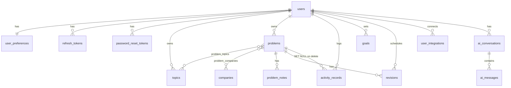

# Database
PostgreSQL 16, SQLAlchemy 2.x models in `backend/app/models.py`, migrations in `backend/alembic/`.

## Deviations from the requested table list (honest notes)
- `problems` merges `problems` + `user_problems` (every problem row belongs to one user; no shared global catalogue).
- `bookmarks` is a boolean column on `problems`.
- `daily_activity` is not a table: daily totals are computed from `activity_records` (so they follow the user's timezone).
- Extra tables: `password_reset_tokens`, `api_error_logs` (admin error monitoring).
## Integrity
All user-owned tables have `user_id` FKs with `ON DELETE CASCADE`; unique constraints: `users.email`, `topics(user_id,name)`, `problems(user_id,leetcode_slug)`, `user_integrations(user_id,provider)`. Every query in the API filters by the authenticated `user_id`.
## Migrations
`0001_initial_schema` creates the baseline from the model metadata (it was **not executed against PostgreSQL** when generated). After first run, `alembic check` should report no drift. Future changes: `alembic revision --autogenerate -m "message"`, review, `alembic upgrade head`. The app never auto-creates tables at startup.
